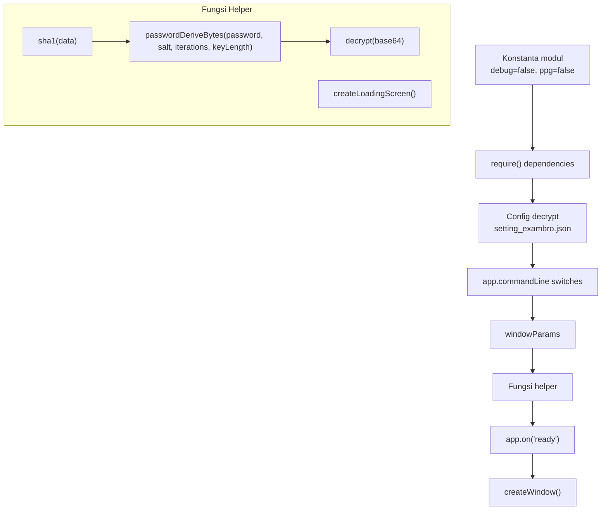
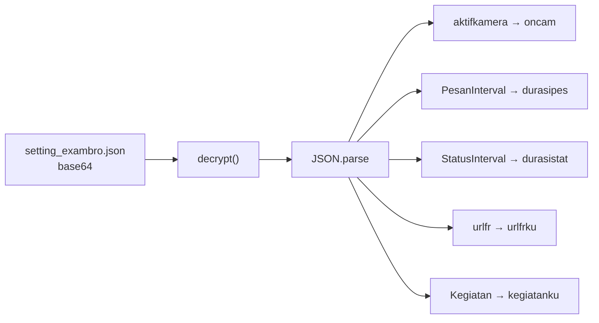
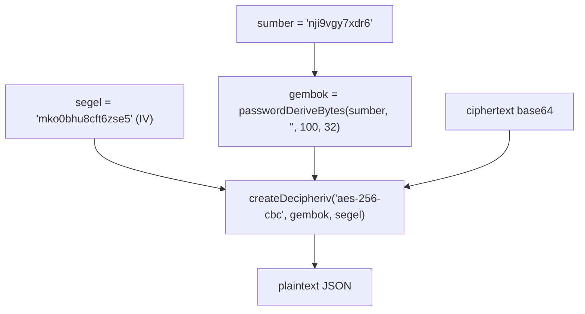
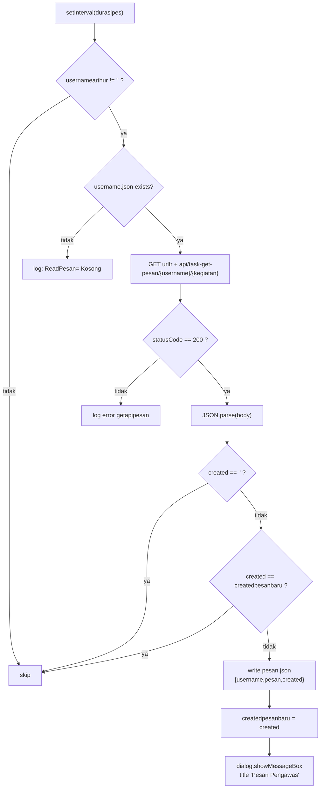
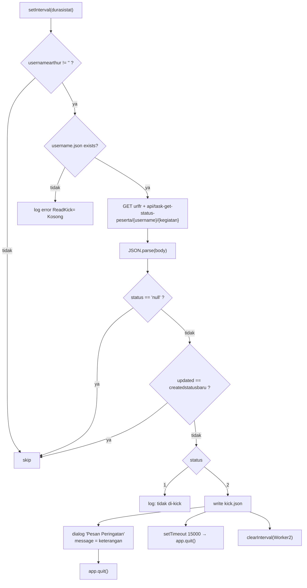
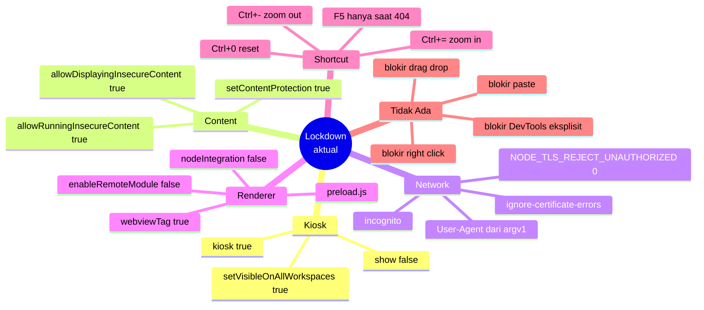

# ExamBrowser Client 26.0222 — Deobfuscation & Code Analysis

> Hasil deobfuscation nyata (`webcrack`) + analisis baris-per-baris.
> Status: JS ✅ selesai | .NET ✅ selesai (dekompilasi lengkap — lihat `REVERSE_ENGINEERING.md`)

---

## 1. Metode Deobfuscation

| Item | Detail |
|---|---|
| File target | `Application/service/elekbrowser/resources/app/main.js` |
| Ukuran asli | 18.7 KB, **1 baris** |
| Obfuscator | `javascript-obfuscator` (pola `_0x104b91`, `_0x162f`) |
| Tool | `webcrack` (string array + string array rotate + decoder inline + control flow) |
| Hasil | **638 perubahan**, 491 baris; string-array/control-flow hilang, identifier lokal masih `_0x*` (281 token) |
| Output | `DECOMPILED/js/deobfuscated.js` |
| Anotasi | `DECOMPILED/js/main.annotated.js` (620 baris, token-identik) |

Bukti transformasi:

```
String Array            : _0x162f, length 172
String Array Rotate     : yes
String Array Decoders   : _0x46df
inline-decoder-wrappers : 339 changes
inline-decoded-strings  : 295 changes
dead-code/control-flow  : 1 change
transpile/unminify      : 596 changes
TOTAL deobfuscate       : 638 changes
```

Verifikasi: `node --check` exit 0. Token stream input vs output **3189 = 3189**, identik 1:1 → tidak ada perubahan logika saat anotasi.

**Catatan:** `preload.js` dan `renderer.js` **tidak diobfuscate** — keduanya template Electron polos (renderer.js seluruhnya komentar).

---

## 2. Struktur Modul `main.js`



---

## 3. Peta Fungsi Lengkap

| # | Fungsi / Handler | Lokasi (deobf) | Tanggung jawab |
|---|---|---|---|
| 1 | `sha1(data)` | 81-83 | Hash SHA-1 → Buffer |
| 2 | `passwordDeriveBytes(pwd, salt, iter, len)` | 84-96 | Derivasi key ala .NET `PasswordDeriveBytes` (SHA-1 iteratif) |
| 3 | `decrypt(base64)` | 97-103 | AES-256-CBC decrypt config |
| 4 | `createWindow()` | 104-464 | Membangun window kiosk + semua handler |
| 5 | `createLoadingScreen()` | 465-473 | Window loading (❗tidak pernah dipanggil) |
| 6 | `app.on("ready")` | 475-477 | Entry point → `createWindow()` |
| 7 | `app.on("window-all-closed")` | 478-482 | Quit kecuali macOS |
| 8 | `app.on("activate")` | 483-487 | Re-create window |
| 9 | `Menu.buildFromTemplate` | 488-491 | Menu dari `process.argv[2]` |

### 3.1 Handler di dalam `createWindow()`

| # | Handler | Baris | Perilaku nyata |
|---|---|---|---|
| 10 | `session.webRequest.onBeforeSendHeaders` | 114-120 | **Inject `User-Agent = process.argv[1]`** ke semua request |
| 11 | `did-finish-load` (1) | 148-161 | `win.show()` + register zoom `Ctrl+= / Ctrl+- / Ctrl+0` |
| 12 | `did-finish-load` (2) | 163-207 | Ambil username dari DOM / response header |
| 13 | `did-finish-load` (3) | 209-251 | Tulis `username.json` + `statuskirim` |
| 14 | `new-window` | 252-275 | Cegah popup native, buat BrowserWindow manual |
| 15 | `session.on("will-download")` | 276-302 | Simpan ke Documents + prefix timestamp |
| 16 | `did-fail-load` | 303-322 | Buka `404.html`, daftarkan `F5` untuk reload |
| 17 | `did-navigate` | 323-342 | Cek HTTP 500 → `404.html` |
| 18 | `Worker1 = setInterval` | 344-389 | Polling pesan pengawas |
| 19 | `Worker2 = setInterval` | 390-455 | Polling status kick |
| 20 | `win.on("closed")` | 457-463 | Clear interval |

---

## 4. Konfigurasi — Dekripsi & Field yang Dipakai



**Penting:** field yang dibaca kode hanya **5**. Field lain (`urlonline`, `hash64`, `validram`, dll.) **tidak** dipakai `main.js` — validasi itu ada di sisi .NET.

### 4.1 Algoritma Kriptografi (verified dari kode)



Trace `passwordDeriveBytes`:

```
buffer = Buffer.from(password + salt)        // salt = ""
repeat 100x: buffer = SHA1(buffer)           // 100 iterasi
if len < keyLength:
    prev = passwordDeriveBytes(pwd, salt, iter-1, 20)
    for i in 1.. : buffer += SHA1(i.toString() + prev)
return Buffer.alloc(keyLength, buffer)       // 32 byte
```

| Parameter | Nilai |
|---|---|
| Password | `nji9vgy7xdr6` |
| Salt | `""` |
| Iterasi | `100` |
| Panjang key | `32` byte |
| Algoritma | `aes-256-cbc` |
| IV | `mko0bhu8cft6zse5` (16 byte) |

> ⚠️ `Buffer.alloc(32, hashBuffer)` mengisi 32 byte dengan **pengulangan** buffer hash. Karena hash SHA-1 = 20 byte, hasilnya = 20 byte hash + 12 byte pertama hash diulang.

---

## 5. Alur Runtime — Sequence Nyata

```mermaid
sequenceDiagram
    participant ELK as elekbrowser.exe
    participant MAIN as main.js
    participant CFG as setting_exambro.json
    participant SRV as urlfr server

    ELK->>MAIN: app ready
    MAIN->>CFG: readFileSync("setting_exambro.json")
    MAIN->>MAIN: decrypt() → JSON.parse
    Note over MAIN: oncam, durasipes, durasistat,<br/>urlfrku, kegiatanku

    MAIN->>MAIN: appendSwitch(ignore-certificate-errors)
    MAIN->>MAIN: appendSwitch(incognito)

    MAIN->>MAIN: new BrowserWindow(windowParams)
    MAIN->>SRV: loadURL(process.argv[3], pragma:no-cache)
    MAIN->>MAIN: session.clearCache()
    MAIN->>MAIN: setContentProtection(true)

    MAIN->>SRV: [semua request] User-Agent = process.argv[1]

    SRV-->>MAIN: did-finish-load #1
    MAIN->>MAIN: win.show() + register Ctrl+=/-/0

    SRV-->>MAIN: did-finish-load #2 (jika oncam==1)
    MAIN->>MAIN: executeJavaScript #exambrousername
    MAIN->>MAIN: tulis username.json {username, statuskirim:"1"}

    SRV-->>MAIN: did-finish-load #3
    alt URL contains "/Account/"
        MAIN->>MAIN: username="" ; statuskirim="2"
    else URL contains "Test/TestSelesai?"
        MAIN->>MAIN: statuskirim="2"
    else
        MAIN->>MAIN: statuskirim="1"
    end
    MAIN->>MAIN: tulis username.json

    loop setiap durasipes (PesanInterval)
        MAIN->>SRV: GET api/task-get-pesan/{username}/{kegiatan}
        SRV-->>MAIN: {username, pesan, created}
        alt created != createdpesanbaru
            MAIN->>MAIN: tulis pesan.json
            MAIN->>MAIN: dialog "Pesan Pengawas"
        end
    end

    loop setiap durasistat (StatusInterval)
        MAIN->>SRV: GET api/task-get-status-peserta/{username}/{kegiatan}
        SRV-->>MAIN: {status, updated, peserta, keterangan}
        alt status == "2" dan updated != createdstatusbaru
            MAIN->>MAIN: tulis kick.json
            MAIN->>MAIN: dialog "Pesan Peringatan"
            MAIN->>MAIN: app.quit() (atau timeout 15s)
            MAIN->>MAIN: clearInterval(Worker2)
        end
    end
```

---

## 6. Worker 1 — Pesan Pengawas



**Catatan:** `app.commandLine.appendSwitch('ignore-certificate-errors')` dipanggil **di dalam** worker — switch ini tidak berpengaruh setelah app ready (dead code efektif).

---

## 7. Worker 2 — Kick Peserta



**Penting:** `process.env.NODE_TLS_REJECT_UNAUTHORIZED = 0` di-set di dalam worker → **semua** TLS verification dimatikan setelah worker pertama jalan.

---

## 8. Perbandingan: Klaim vs Kode Nyata

| Klaim awal | Kode nyata | Status |
|---|---|---|
| `characteriseUrl` deteksi login | Cek literal `https://anbk-layanan.pusmendik.kemdikbud.go.id/Account/` | ✅ dikoreksi lebih spesifik |
| Worker interval dari config 300s | Dari `PesanInterval` / `StatusInterval`; bisa `undefined` | ⚠️ dikoreksi |
| `cfg.urlsemionline` / `urlonline` dipakai | **Tidak** dipakai `main.js`, hanya `urlfr` | ❌ klaim awal salah |
| `hash64`/`hash32` divalidasi | Tidak ada di `main.js` | ❌ klaim awal salah |
| Zoom `Ctrl+=/-/0` | Benar, terdaftar saat `did-finish-load` | ✅ |
| Anti-screenshot `setContentProtection` | Benar | ✅ |
| `nodeIntegration:false` window utama | Benar, tapi error-window pakai `true` | ⚠️ inkonsisten |
| Auto-open download | Tidak; hanya `shell.showItemInFolder()` | ❌ klaim awal salah |
| `createLoadingScreen()` dipakai | **Tidak pernah dipanggil** | ❌ klaim awal salah |

---

## 9. Temuan Bug & Kelemahan (dari kode nyata)

Bukti: 📖 = terbaca langsung dari source + baris.

### 🔴 Tinggi

| # | Temuan | Bukti | Dampak |
|---|---|---|---|
| 1 | `did-navigate` membandingkan `_0x27f463 == "500"` (string) | baris 323-325 | Electron mengirim **number**, jadi kondisi tidak pernah true → handler error 500 **mati total** |
| 2 | `Object.assign(windowParams, {...})` memutasi objek global | baris 305, 326, 466 | Window error/loading mewarisi `webPreferences` yang sudah diubah; `nodeIntegration: true` bisa bocor ke window berikutnya |
| 3 | Error-window memakai `nodeIntegration: true` | baris 308 | Halaman `404.html` lokal dapat akses Node penuh; jika path bisa dikendalikan → RCE |
| 4 | `NODE_TLS_REJECT_UNAUTHORIZED = 0` | baris 400 | Seluruh TLS verification mati setelah Worker2 jalan → MITM |
| 5 | `setInterval(fn, undefined)` jika config gagal parse | baris 389, 455 | Node menganggap 0 → clamp 1ms → **hammering server** + CPU spin |

### 🟠 Sedang

| # | Temuan | Bukti |
|---|---|---|
| 6 | `error` dan `loadingScreen` adalah **implicit global** (tanpa `let`/`var`) | baris 305, 466 |
| 7 | Tiga listener `did-finish-load` terpisah pada event yang sama | baris 148, 163, 209 |
| 8 | `statuskirim` di cabang `TestSelesai` menulis `_0x19c9a8` (=2) tapi logika error di callback terbalik | baris 231-239 |
| 9 | `fs.writeFile` error diabaikan (`if (err) {} else {}`) | baris 176, 177, 187, 188, 228, 247 |
| 10 | `createLoadingScreen()` tidak dipanggil → `loading.html` tidak dipakai | baris 465-473 |
| 11 | `new-window` handler memakai API deprecated (Electron 11 masih OK, tapi rapuh) | baris 252 |
| 12 | `session.clearCache()` dipanggil setelah `loadURL` → race | baris 106-109 |
| 13 | `executeJavaScript(...).then(...)` tanpa guard `element == null` → reject ditelan `.catch(()=>{})` | baris 165-190 |
| 14 | `app.commandLine.appendSwitch` di dalam Worker1 tidak berefek (post-ready) | baris 354 |

### 🟡 Rendah

| # | Temuan |
|---|---|
| 15 | `ipcMain` di-import tapi tidak dipakai |
| 16 | `ppg` konstanta `false` — dead branch (`oncam = 1`) |
| 17 | `debug` konstanta `false` — dead branch (DevTools, path file) |
| 18 | Nama variabel asli tidak deskriptif (`mantapmantap`, `hastemp`, `gembok`) |
| 19 | `dateTime` dipakai sekali, `formatted` dihitung sekali di startup → semua download dapat prefix timestamp yang sama |
| 20 | Menu hanya satu item label; `setMenu(null)` pada window error |

---

## 10. Lockdown — Kondisi Nyata



**Koreksi:** tidak ada handler yang memblokir context-menu, DevTools, atau keyboard shortcut lain di `main.js`. Lockdown keyboard sebenarnya dilakukan oleh `runningexam.exe` (.NET) di level OS — bukan oleh Electron.

---

## 11. Argumen CLI `elekbrowser.exe`

| Index | Isi | Dipakai untuk |
|---|---|---|
| `argv[0]` | path exe | — |
| `argv[1]` | User-Agent string | header `User-Agent` semua request |
| `argv[2]` | mode (`"2"` = daring) | label menu |
| `argv[3]` | URL ujian | `win.webContents.loadURL()` |

> Ini menjelaskan kenapa `runningexam.exe.config` punya `BrowserArguments = -incognito -kiosk ...` — switch Electron standar, sementara URL & UA dikirim sebagai positional args.

---

## 12. Status

| Komponen | Status |
|---|---|
| `main.js` deobfuscation | ✅ string-array/control-flow 100%; identifier `_0x*` dirapikan di `main.annotated.js` |
| `main.js` anotasi semantik | ✅ 620 baris, token-identik |
| Fungsi JS dipetakan | ✅ 20 titik masuk |
| Algoritma kripto | ✅ terverifikasi dari kode |
| .NET decompile | ✅ selesai — 6 assembly di `DECOMPILED/dotnet/` |
| Bug hunt JS | ✅ 20 temuan (5 tinggi) |

### Koreksi (2026-10-28)

Dua klaim lama di dokumen ini tidak akurat dan sudah diperbaiki:

1. **Klaim lama:** “0 sisa `_0x*`” / “100% (0 sisa `_0x`)”.
   **Bukti pembantah:** `deobfuscated.js` masih memuat 281 token `_0x*` sebagai nama identifier lokal. Yang bersih adalah `main.annotated.js` (620 baris, hanya 1 `_0x` di komentar).
   **Klaim benar:** webcrack menghapus string-array dan control-flow obfuscation; rename identifier semantik dilakukan terpisah di `main.annotated.js`.
   **Kenapa lolos:** verifikasi lama menghitung string terdekode/properti, bukan token identifier mentah.

2. **Klaim lama:** “.NET ⏳ menunggu runtime”.
   **Bukti pembantah:** dekompilasi 6 assembly sudah selesai di `DECOMPILED/dotnet/`.
   **Klaim benar:** .NET decompile ✅ selesai; lihat `REVERSE_ENGINEERING.md` §3–§5 dan Appendix H.
