# ExamBrowser Client 26.0222 — Reverse Engineering Report

> Full decompilation + deobfuscation | Platform: Windows x64 | Target: .NET CLR v2.0.50727 + Electron 11.5.0

---

## 1. Arsitektur Sistem

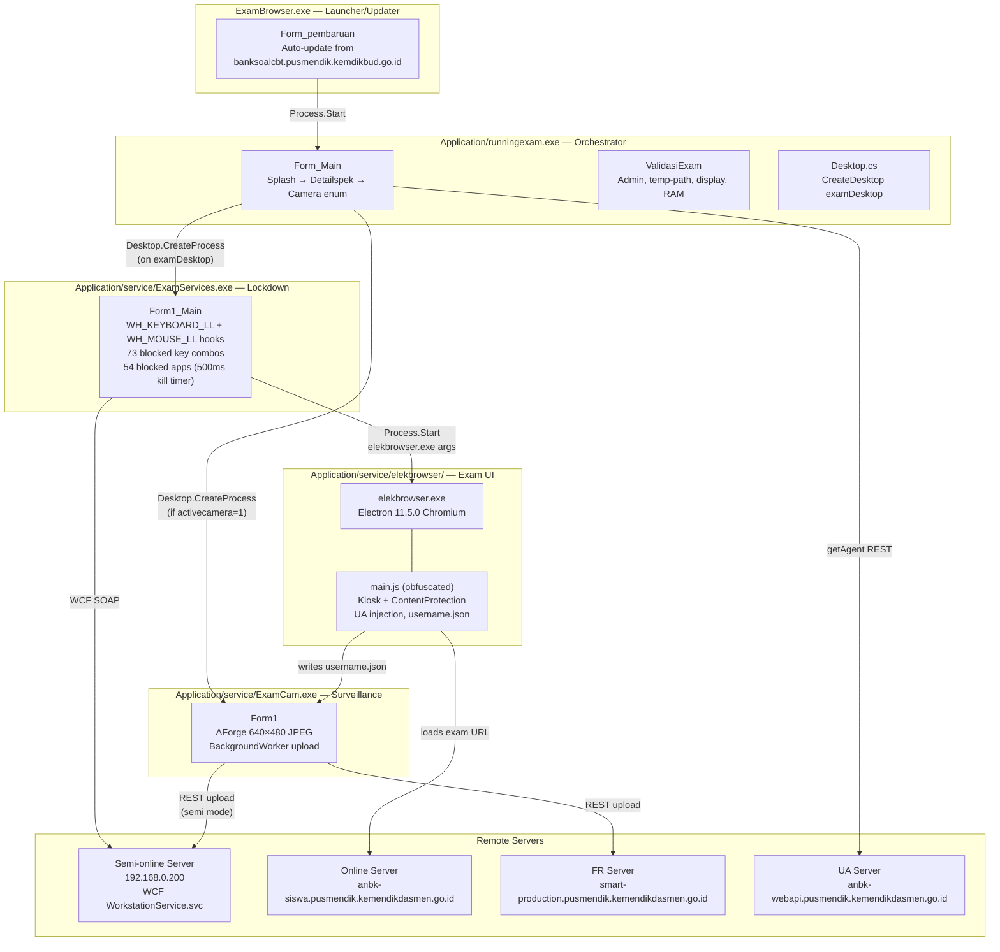

### Process Chain

| Step | Process | Launched By | Desktop |
|------|---------|------------|---------|
| 1 | `ExamBrowser.exe` | User (double-click) | Default |
| 2 | `Application\runningexam.exe` | ExamBrowser (after update check) | Default |
| 3 | `Application\service\ExamServices.exe` | runningexam — `Desktop.CreateProcess` if `validdesktop=1`, else `Process.Start` after `TerminateExplorer()` | `examDesktop` **or** default |
| 4 | `Application\service\ExamCam.exe` | runningexam — same branch, only if `aktifkamera=1` | `examDesktop` **or** default |
| 5 | `Application\service\elekbrowser\elekbrowser.exe` | ExamServices via `Process.Start` | `examDesktop` **or** default |

> ⚠ **Shipped config sets `validdesktop = "0"`** (mapped to `appConfig.bukadesktop`), so the `examDesktop` isolation path is **disabled by default**: the orchestrator instead calls `TerminateExplorer()` and launches services on the normal desktop.

### Key Files

| File | Purpose |
|------|---------|
| `setting_exambro.json` | AES-256-CBC encrypted config (password `nji9vgy7xdr6`, IV `mko0bhu8cft6zse5`) |
| `eb000.dat` | Stored password → decrypts to `nj_fijar` |
| `version.txt` | Local version string `26.0222` |
| `username.json` | `{username, statuskirim}` — IPC between Electron and ExamCam |
| `log.txt` / `cameralog.txt` / `updatelog.txt` | Runtime logs |

---

## 2. Updater — ExamBrowser.exe (Form_pembaruan)

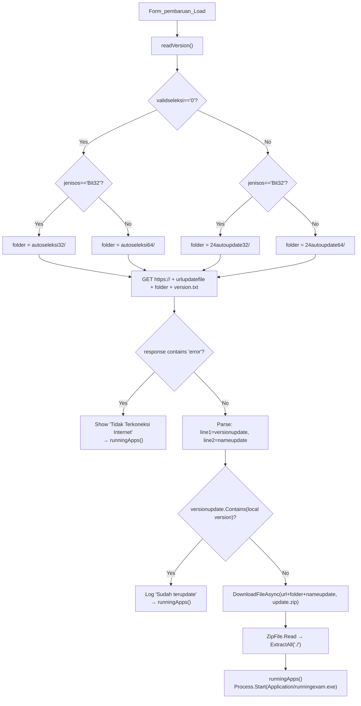

**Static values (verified via reflection):**
- `ExamFile` = `Application\runningexam.exe`
- `namafilezip` = `update.zip`
- `urlupdatefile` = `banksoalcbt.pusmendik.kemdikbud.go.id/` (from `GetConfigure.urlupdatefile`, offset 7238)
- `validseleksi` = `0`, `jenisos` = `Bit64`

> ⚠ `DownloadString()` sets `ServicePointManager.ServerCertificateValidationCallback = (…)=>true` — every TLS certificate is accepted, so the update channel is MITM-able.

**Updater string table (decrypted from embedded resource `Z5moGj8xIc6qu3YH1J.SGTInLkEliyg1aS6Np`, 2092 bytes, MD5-based decryptor):**

| Offset | String |
|--------|--------|
| 0 | `1` |
| 6 | `Bit32` |
| 20 | `autoseleksi32/` |
| 52 | `autoseleksi64/` |
| 84 | `24autoupdate32/` |
| 118 | `24autoupdate64/` |
| 152 | `https://` |
| 172 | `version.txt` |
| 198 | `error` |
| 212 | `Anda Tidak Memiliki akses internet...` |
| 522 | `Tidak Terkoneksi Internet` |
| 576 | `Versi Exambrowser Sudah terupdate` |
| 1076 | `./` |
| 1084 | `Proses Extract Update applikasi Berhasil` |

---

## 3. Orchestrator — runningexam.exe (Form_Main)

### 3.1 Startup Sequence

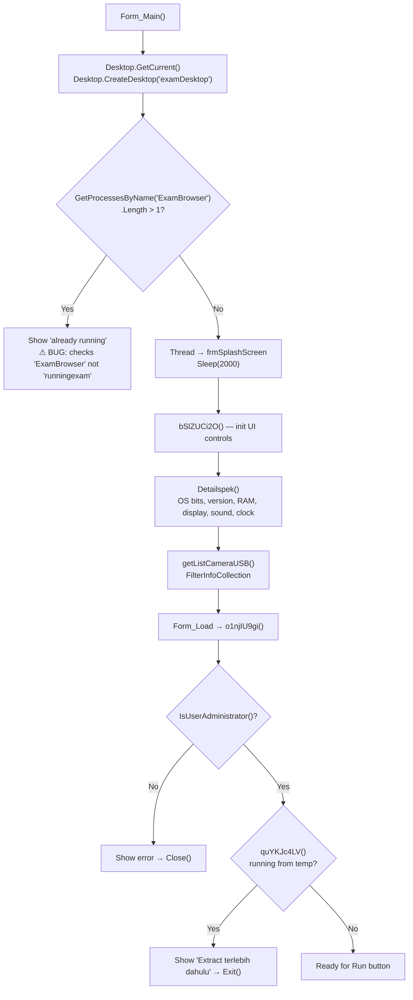

### 3.2 Run Button (OAfqUeaTV) — Start Flow

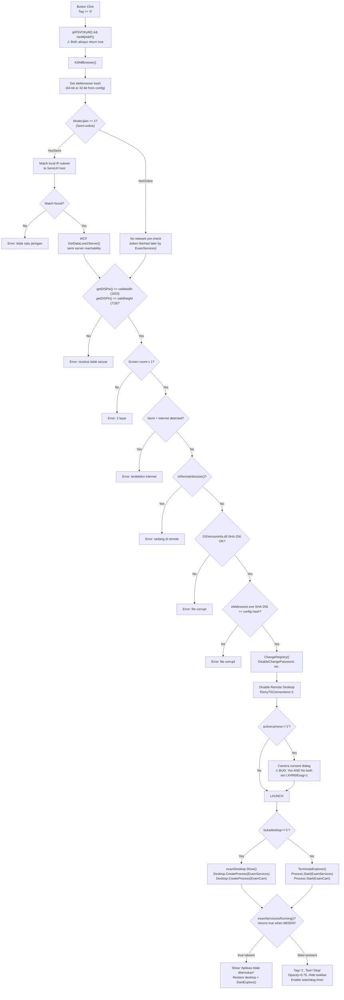

### 3.3 Run Button — Stop Flow

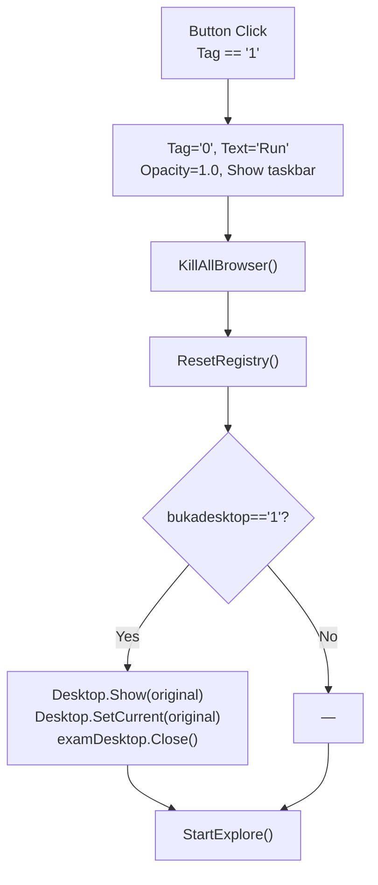

### 3.4 Watchdog Timers

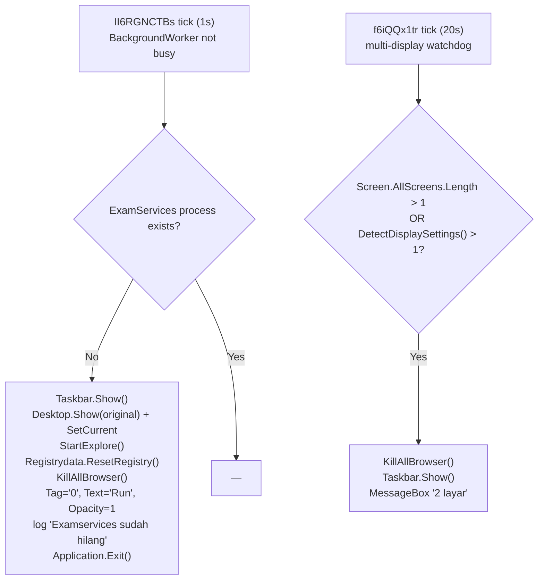

| Timer | Interval | Handler | Purpose |
|-------|----------|---------|---------|
| `II6RGNCTBs` | 1 s | `JMlo8LnXY` → `MpMPlucRT` | ExamServices watchdog → full restore + exit |
| `jC0RRfqE6m` | 20 s | `f6iQQx1tr` | Multi-display detection → kill browsers |
| `IejRTnkyvy` | 6 s | `v3gyuQiN4` | Clock display refresh |
| `DlgRSLrT2l` | 5 s | `iNlvuSI1Z` | Count processes (log/status) |
| `sVxkWoDgk` | 10 s | `DvK8XsCKV` | Clear transient status text |

---

## 4. Lockdown — ExamServices.exe (Form1_Main)

### 4.1 Startup & Guards

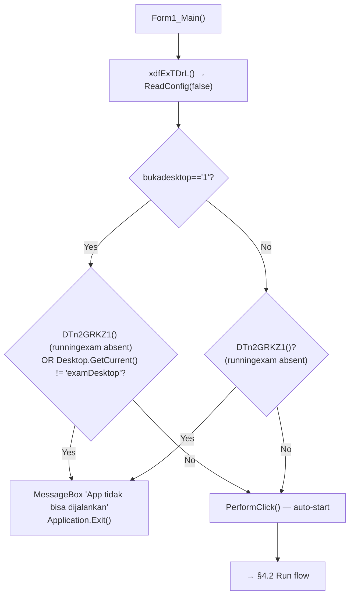

> `xdfExTDrL()` runs at startup and automatically clicks Run if the guards pass. `ReadConfig(false)` only parses config; the key tables are built later inside the Run handler.

### 4.2 Run Button (erMBXTXW7) — Browser Launch

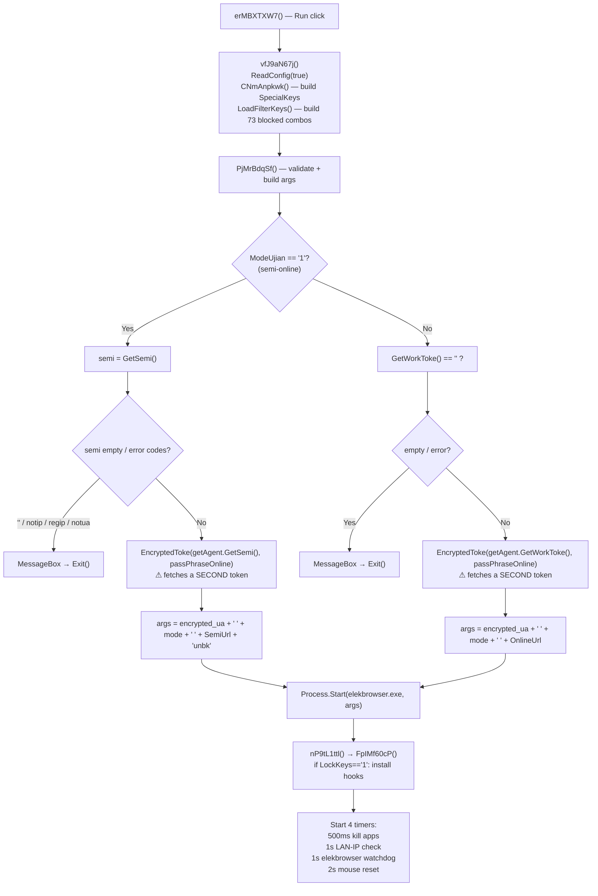

### 4.3 Key Blocking (Pk0UhXj6T / GOdvmdH0g)

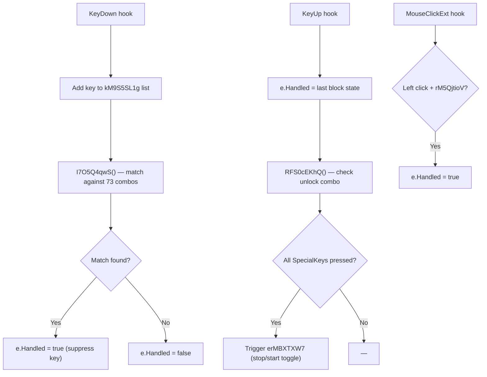

**Default unlock combo:** `LControlKey` + `C` + `B` (from config `unlockkeys`)

### 4.4 App Kill Timer (500ms)

Kills any process matching the 54 names in `LoadApplication()`: `notepad`, `firefox`, `calc`, `calculator`, `acrobat`, `winword`, `excel`, `powerpnt`, `taskmgr`, `teamviewer`, `anydesk`, `ultraviewer_service`, `vncserver`, `radmin`, `rutserv`, etc. (full list in Appendix F)

---

## 5. Camera Surveillance — ExamCam.exe (Form1)

### 5.1 Initialization

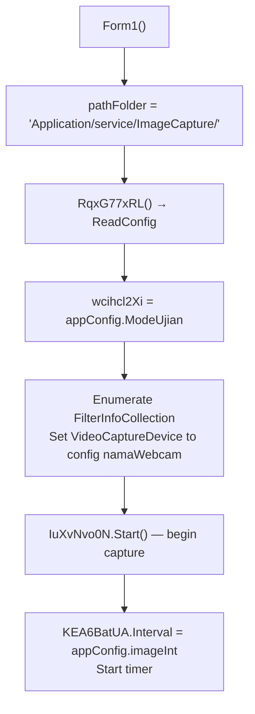

### 5.2 Capture & Upload Cycle

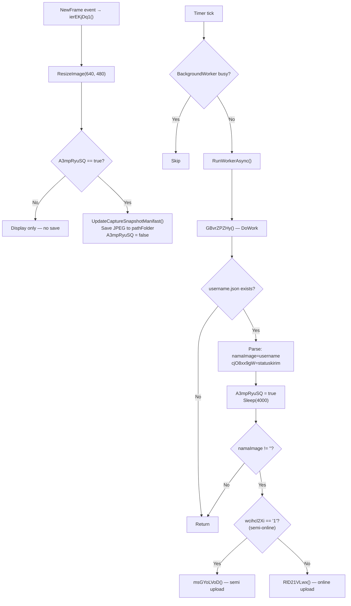

### 5.3 Upload Endpoints

**Semi-online mode (`msGYoLVoD`):**
- URL: hardcoded `https://192.168.0.200/unbk/api/workstation/upload-fr-image`
- Headers: `Reveal: anaslopyanto`
- Params: `UserName` = username, `File` = JPEG multipart
- Gate: `cjO8xx9gW == "1"` (statuskirim)

**Online mode (`RlD21VLwx`):**
- URL: `FRUrl + "imagedariexambrowser/"` (config)
- Params: `username`, `key` = keyfrku, `gambar` = JPEG, `status=1`, `nama_kegiatan` = Kegiatan, `token` = tokenfrku
- Gate: `cjO8xx9gW == "1"` (statuskirim)

**Upload only happens when `statuskirim == "1"`** (set by main.js during active exam). When `"2"` (login/finished page), no upload.

---

## 6. Electron Browser — main.js

### 6.1 Startup & Config

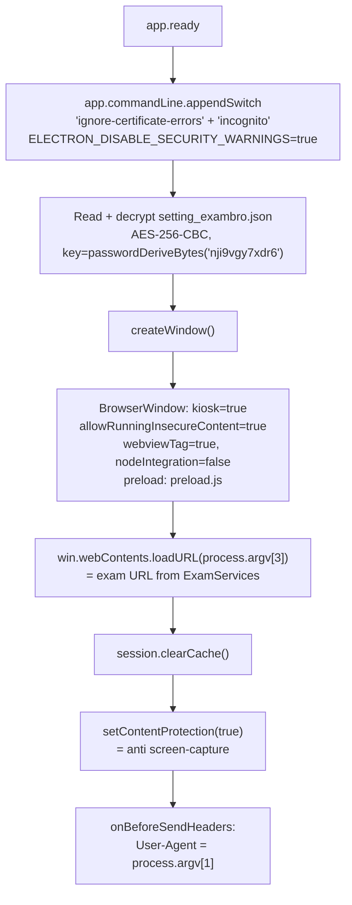

### 6.2 Username Detection & IPC

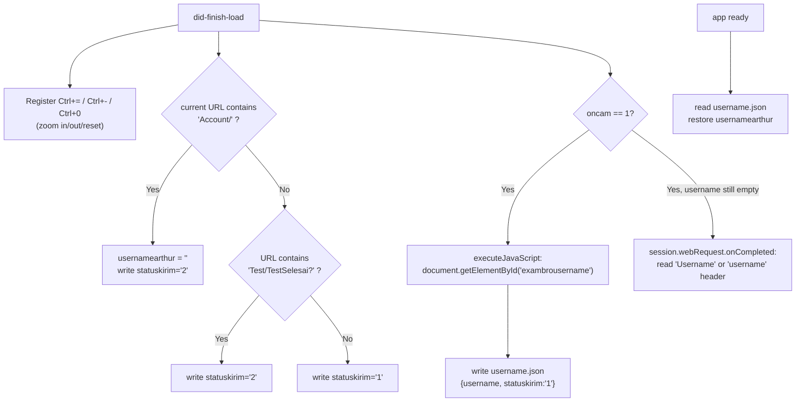

### 6.3 Workers (camera mode only, `oncam == 1`)

| Worker | Interval (config) | Endpoint | Action |
|--------|-------------------|----------|--------|
| Worker1 | `PesanInterval` (`durasipes`) | `urlfr + api/task-get-pesan/{username}/{Kegiatan}` | Poll proctor messages → `pesan.json` → dialog |
| Worker2 | `StatusInterval` (`durasistat`) | `urlfr + api/task-get-status-peserta/{username}/{Kegiatan}` | Poll student status → if `"2"` → `kick.json` → dialog → `app.quit()` (15 s timeout fallback) |

### 6.4 argv mapping

| Index | Value | Source |
|-------|-------|--------|
| `argv[1]` | Encrypted User-Agent token | ExamServices `EncryptedToke()` |
| `argv[2]` | Mode (`"1"` semi / `"2"` online) | `appConfig.ModeUjian` |
| `argv[3]` | Exam URL | `SemiUrl+"unbk"` or `OnlineUrl` |

### 6.5 Hardcoded Login Detection

```javascript
// BUG: hardcoded to old domain, not configurable
if (currentUrl.includes("https://anbk-layanan.pusmendik.kemdikbud.go.id/Account/")) {
    // login page logic
}
```
This does NOT match the configured `urlonline` host (`anbk-siswa.pusmendik.kemendikdasmen.go.id`).

---

## 7. Cryptography & Configuration

### 7.1 AES-256-CBC Encryption (LibraryExam.encryption)

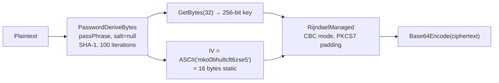

| Parameter | Value | Used For |
|-----------|-------|----------|
| `passPhrase` | `nji9vgy7xdr6` | `setting_exambro.json` read/write |
| `passPhraseOnline` | `mji6tui7xdl5` | `EncryptedToke()` — UA token for elekbrowser |
| IV | `mko0bhu8cft6zse5` | All operations (static) |
| KDF | `PasswordDeriveBytes` (PBKDF1-SHA1) | Key derivation |
| Iterations | 100 | — |
| Salt | `null` | ⚠ No salt = deterministic key |

**Weakness:** No salt → same passPhrase always produces same key. IV is static → identical plaintexts produce identical ciphertexts. PBKDF1 with 100 iterations is trivially brutable.

### 7.2 Config Schema (setting_exambro.json)

Two copies exist and they are **not identical** — the launcher copy is current (v26.0222), the Electron copy is stale (v22.1205) with different URLs.

| Field | Launcher copy (26.0222) | Electron copy (22.1205) | Purpose |
|-------|------------------------|-------------------------|---------|
| `passwd` | `12345` | `12345` | UI password |
| `nameapps` | `Exambrowser Client` | `Exam Sistem Penilaian Pendidikan` | Display name |
| `versi` | `26.0222` | `22.1205` | Version |
| `jenisbit` | `Bit64` | `Bit64` | Build arch |
| `hash64` | `1DE9FE76…4C0F` | `8433FDEB…C9D1` | SHA-256 of `elekbrowser.exe` (64-bit) |
| `hash32` | `2E114F0F…F053` | `2E114F0F…F053` | SHA-256 of `elekbrowser.exe` (32-bit) |
| `moda` | `2` | `2` | Mode: `1`=semi-online, `2`=online |
| `unlockkeys` | `LControlKey,C,B` | `LControlKey,C,B` | Unlock combo |
| `aktifkamera` | `1` | `0` | Enable camera |
| `HeartInterval` | `600000` | `600000` | Heartbeat ms (⚠ unused) |
| `ImageInterval` | `300000` | `30000` | Camera capture interval ms |
| `StatusInterval` | `300000` | `20000` | Status poll interval ms |
| `PesanInterval` | `300000` | `20000` | Message poll interval ms |
| `Kegiatan` | `2020` | `2020` | Exam event name |
| `Webcam` | `0` | `0` | Camera index |
| `validwidth` / `validheight` | `1023` / `719` | same | Min resolution (check is `<`) |
| `validram` | `1024` | `1024` | Min RAM MB |
| `sharingsession` | `1` | `0` | Session sharing flag |
| `osversion` | `{validwin7/8/10/2012/2008: "1"}` | same | Allowed OS versions |
| `urlsemionline` | `https://192.168.0.200/` | `https://192.168.0.200/` | Semi-online server |
| `urlonline` | `https://anbk-siswa.pusmendik.kemendikdasmen.go.id` | `http://118.98.236.40:8093/` | Online exam URL |
| `urlfr` | `https://smart-production.pusmendik.kemendikdasmen.go.id/` | `https://smart.pusmendik.kemdikbud.go.id/` | Face-recognition API |
| `validdesktop` | `0` | `1` | Require `examDesktop` |
| `validparsemi` | `FAH` | `FAH` | Semi-online auth param |
| `validparonline` | `JANU` | `JANU` | Online auth param |
| `urlgetagent` | `https://anbk-webapi.pusmendik.kemendikdasmen.go.id/auth/api/v1/user-agent/generate` | `https://anbk-production.pusmendik.kemdikbud.go.id/ubkapi/api/workstation/token/` | Agent token endpoint |
| `validseleksi` | `0` | `0` | Selection/autoupdate folder switch |
| `jenisapps` | `radya` | — | App vendor tag |

Additional `AppConfig` fields populated at runtime (not present in JSON): `Password`, `BrowserFilename`, `BrowserArguments`, `SemiUrl`, `OnlineUrl`, `FRUrl`, `TimerInterval`, `LockKeys`, `DebugMode`, `SpecialKeys[]`, `FilteredKeys[]`, `Application[]`, `SendF11Stroke`, `SharingSession`, `ModeUjian`, `PasswordSetUrl`, `Error`, `Error_Message`, `OSType`, `has64`, `has32`, `activecamera`, `versiexam`, `namaApps`, `bukadesktop`, `parSemi`, `parOnline`, `namaWebcam`, `imageInt`, `getagenturl`.

`validseleksi` switches the updater folder: `0` → `autoseleksi{32,64}/`, else → `24autoupdate{32,64}/`.

### 7.3 eb000.dat

- Contains: `encryption.Decrypt("...", "nji9vgy7xdr6")`
- Decrypted value: `nj_fijar`
- Used as: stored password validation (compared against user-entered password on UI)

### 7.4 Obfuscator String Encryption (.NET assemblies)

All 4 main assemblies (LibraryExam, runningexam, ExamServices, ExamCam) use the same pattern:

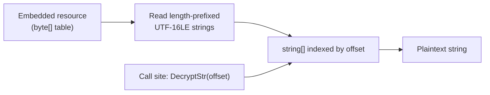

| Assembly | Resource size | Entries |
|----------|--------------|---------|
| LibraryExam.dll | 8,266 B | 243 |
| runningexam.exe | 13,634 B | 349 |
| ExamServices.exe | 2,152 B | 59 |
| ExamCam.exe | 1,368 B | 42 |
| ExamBrowser.exe | 2,092 B | 45 (MD5-based decryptor) |

### 7.5 ExamBrowser.exe Anti-Tamper

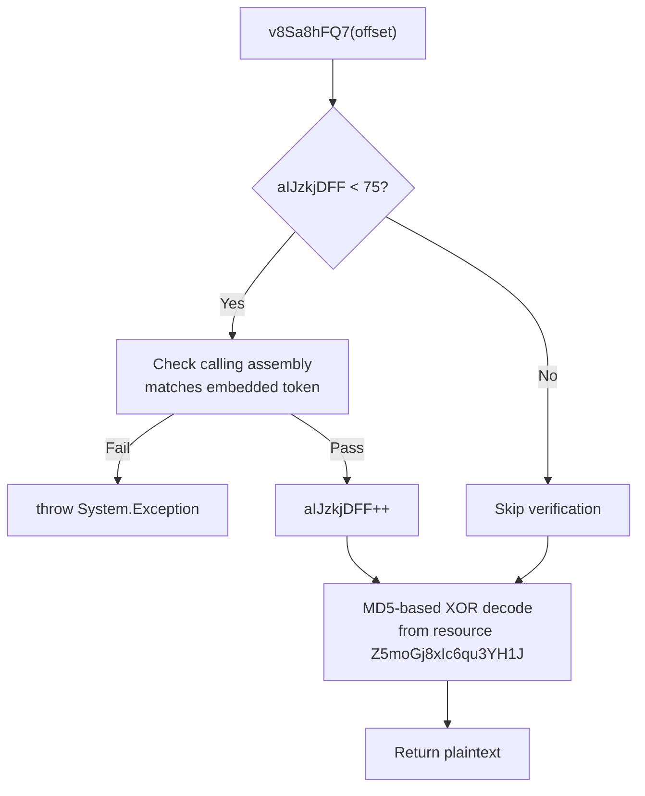

Bypass: Set `aIJzkjDFF = 75` via reflection before any calls.

### 7.6 Obfuscation Architecture

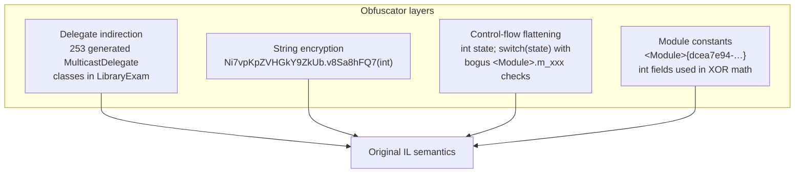

| Layer | Detail |
|-------|--------|
| Delegate indirection | 253 tiny classes (`ElLnNK3f9vQF9r9J0Jy`, `oNmLTvRmCnkp6KBCERC`, …), each wrapping one BCL call via `static AtVKHSDIv(args, instance)`; direct calls become `Class.AtVKHSDIv(x, Class.Field)` |
| String encryption | All literals replaced by `v8Sa8hFQ7(int)`; argument is `offset ^ moduleConstant`, resolved offline |
| Control-flow flattening | Every method becomes `int num = N; for(;;){ switch(num){ … } }` with dead branches gated on `<Module>` int fields |
| Module constants | `<Module>{dcea7e94-9ff4-4fd7-8791-a8b9cb501aa0}` singleton holds ~126 int fields; values differ per build |
| Anti-tamper (launcher) | `aIJzkjDFF` call counter + calling-assembly check (see 7.5) |

---

## 8. WCF & Network Surface

### 8.1 Semi-Online WCF (WorkstationService.svc)

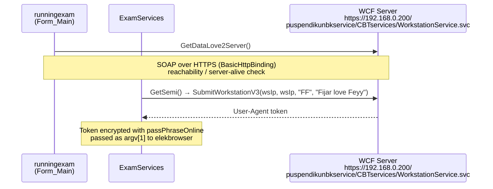

**Magic constants:**
- `"FF"` — fixed parameter (meaning unknown)
- `"Fijar love Feyy"` — authentication passphrase (developer signature)
- Service path `puspendikunbkservice/CBTservices/WorkstationService.svc` is a static field (`GetConfigure.urlservicesvhd`), while `<host>` is hardcoded to `192.168.0.200` in ExamServices — **not** read from config `urlsemionline`.

### 8.2 Online REST API (getAgent)

| Endpoint | Method | Purpose |
|----------|--------|---------|
| `urlgetagent` + path | POST | `GetWorkToke()` — get UA token |
| `FRUrl` + `imagedariexambrowser/` | POST multipart | Upload camera frame |
| Semi: `192.168.0.200/unbk/api/workstation/upload-fr-image` | POST multipart | Upload camera frame (semi) |
| `api/task-get-pesan` | GET | Poll proctor messages |
| `api/task-get-status-peserta` | GET | Poll student kick status |

### 8.3 Request Headers

| Header | Value | Used By |
|--------|-------|---------|
| `User-Agent` | Encrypted token (argv[1]) | Electron main.js |
| `reveal` | `anaslopyanto` | getAgent + ExamCam semi-mode upload |
| `Authorization` | `cmFkeWEgdGVrbm9sb2dpIGRpZ2l0YWw=` → `radya teknologi digital` | getAgent REST calls |
| `Content-Type` | `text/plain` / `multipart/form-data` | Token requests / camera uploads |

### 8.4 Network Validation

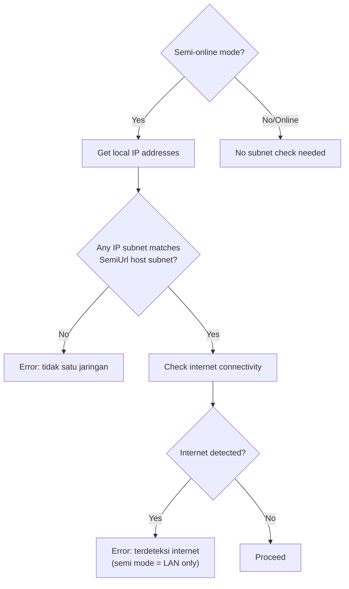

### 8.5 TLS Posture — Validation Disabled in Every Layer

Certificate validation is bypassed across the whole stack, not just in the updater:

| Component | Location | Mechanism | Effective protocol |
|-----------|----------|-----------|--------------------|
| `runningexam` (WCF `GetDataLove2Server`) | `Form_Main.cs:294` | `ServerCertificateValidationCallback` → `Form_Main.<>c.JZBaNOOtlR`; IL is `ldc.i4.1; ret` | TLS 1.2 + TLS 1.0 |
| `ExamCam` (both upload paths) | `Form1.cs:246,261,293,305` | callbacks `f69T2mQLG`, `uvXP7rmKq`, `gwCoxLk2P`, `kx8VF0yUC`; IL all `ldc.i4.1; ret` | TLS 1.2 + TLS 1.0, fallback `Ssl3 \| Tls` |
| `ExamBrowser` updater | `Form_pembaruan.cs:98,118,160,166` | inline `(sender, cert, chain, errors) => true` | TLS 1.2 + TLS 1.0, fallback `Ssl3 \| Tls` |
| Electron `main.js` | lines 64, 354, 400 | `appendSwitch("ignore-certificate-errors")`; `NODE_TLS_REJECT_UNAUTHORIZED = 0` | any |
| `getAgent` REST | `getAgent.cs:81,177,252,320,484,576` | no own callback, but sets `(SecurityProtocolType)3264` / `Ssl3 \| Tls` and inherits the global callback | TLS 1.2 + TLS 1.0 |

> `3264` = `Tls12 (3072) | Tls (192)`. The fallback branch (`Ssl3 | Tls`) is triggered by `NotSupportedException` and re-enables SSL 3.0, which is broken (POODLE).

**Impact:** an attacker on the network path can impersonate the update server, the semi-online WCF endpoint, the FR image API, and the exam page itself. Because `update.zip` is extracted directly over the install directory, a MITM can achieve code execution as the exam user (who is required to be a local administrator).

---

## 9. Bug Hunt — Findings

| # | Severity | Location | Description |
|---|----------|----------|-------------|
| 1 | 🔴 High | `Form_Main` constructor | **Wrong process name in single-instance check.** Checks `GetProcessesByName("ExamBrowser")` but the process is `runningexam`. Multiple instances can run simultaneously. |
| 2 | 🔴 High | `Form_Main.OAfqUeaTV` | **Camera consent dialog is a no-op.** Both Yes and No branches set `LXHRt0Eoqg = "1"` (camera enabled). User cannot decline camera. |
| 3 | 🟢 Low | `ValidasiExam.examServicesisRunning()` | **Misleading method name.** Body is `return Process.GetProcessesByName("ExamServices").Length < 1;` — i.e. it returns `true` when the service is **absent**. The call site uses it correctly, but the inverted naming is a maintenance trap. |
| 4 | 🟡 Medium | `Form_Main` | **`qATbVOKyM()` and `HeMfjAI6P()` always return true.** Dead validation gates — whatever they were meant to check is bypassed. |
| 5 | 🟡 Medium | `Form_Main` | **`HeartInterval` config field read but never used.** Heartbeat timer was planned but not implemented. |
| 6 | 🟡 Medium | `Form_pembaruan` | **`Contains()` for version comparison.** `versionupdate.Contains(localVersion)` means `"26.0222-beta"` would match `"26.0222"`, skipping a required update. Should use exact equality. |
| 7 | 🟡 Medium | `main.js` | **Hardcoded login URL mismatch.** Login detection checks `anbk-layanan.pusmendik.kemdikbud.go.id` but config URL is `anbk-siswa.pusmendik.kemendikdasmen.go.id`. Username detection fails on the real exam domain. |
| 8 | 🟡 Medium | `ExamCam.msGYoLVoD` | **Hardcoded semi-mode camera upload URL.** Uses `https://192.168.0.200/unbk/api/...` instead of reading from config `urlsemionline`. Won't work if server IP changes. |
| 9 | 🟢 Low | `GetConfigure.LoadApplication()` | **Duplicate entries in blocked app list.** `AnyDesk` ×3, `ROMFUSClient` ×2, `RPCSuite` ×2, `vncviewer` ×2. No functional impact, but indicates copy-paste maintenance. |
| 10 | 🟢 Low | `encryption.cs` | **No salt, static IV, PBKDF1 with 100 iterations.** Deterministic encryption — same plaintext always produces same ciphertext. Not a practical risk for local config but violates crypto best practices. |
| 11 | 🟢 Low | `main.js` | **Electron 11.5.0 (Chromium 87).** End-of-life since Feb 2021. Known CVEs in Chromium 87. |
| 12 | 🟢 Low | `GetConfigure.KillAllBrowser` | **Kills by process name list.** A renamed browser process would evade detection. |
| 13 | 🟢 Low | `ExamServices` | **Hook-based key blocking can be bypassed.** `WH_KEYBOARD_LL` hooks can be removed by another process with sufficient privilege. |
| 14 | 🟢 Low | `Desktop.cs` | **`CreateDesktop` lockdown is user-mode only.** A process launched on the original desktop can still interact via Win32 APIs. |
| 15 | 🟢 Info | `WCF` | **`"Fijar love Feyy"` hardcoded auth string.** Developer signature in production code — not a security issue per se but reveals internal naming. |
| 16 | 🟢 Info | `ExamCam` | **`Reveal: anaslopyanto` header.** Custom auth header hardcoded — easily spoofed. |
| 17 | 🟡 Medium | `main.js:72-79` | **Hardened-looking but permissive `webPreferences`.** `nodeIntegration: false` yet `contextIsolation` is unset (defaults to `false` in Electron 11), `webviewTag: true`, `allowRunningInsecureContent: true`, `allowDisplayingInsecureContent: true`. Any injected content runs with the preload bridge in the same context. |
| 18 | 🟢 Info | `eb000.dat` | **Stored password `nj_fijar`.** Default password discoverable via config decryption. |
| 19 | 🟢 Info | General | **All crypto keys in binary.** `nji9vgy7xdr6`, `mji6tui7xdl5`, `mko0bhu8cft6zse5` — extractable from decompiled source. |
| 20 | 🔴 High | `Form_pembaruan.DownloadString` | **TLS certificate validation disabled in updater.** `ServicePointManager.ServerCertificateValidationCallback = (…)=>true` accepts any certificate, and the fallback path downgrades to `Ssl3 \| Tls`. Combined with no pinning, a MITM can serve a malicious `update.zip` that is extracted straight over the install directory. |
| 21 | 🔴 High | `main.js:64,354,400`; `Form_Main.cs:294`; `ExamCam/Form1.cs:246,261,293,305`; `Form_pembaruan.cs:98,118,160,166` | **TLS verification disabled in every layer.** Electron: `ignore-certificate-errors` + `NODE_TLS_REJECT_UNAUTHORIZED=0`. .NET: all `ServerCertificateValidationCallback` delegates return `true` (IL `ldc.i4.1; ret`), and the fallback path downgrades to `Ssl3 \| Tls`. Any network attacker can impersonate the exam, WCF, FR, and update servers. See §8.5. |
| 22 | 🟡 Medium | `main.js:345,391` | **Proctor workers only run if `username.json` already exists.** `if (!fs.existsSync(fileusername))` logs "Kosong" and skips the poll — so before the first username write, kick/message checks silently never happen. |
| 23 | 🟡 Medium | `ExamServices.PjMrBdqSf` | **Token endpoint called twice per launch.** Semi: `semi = GetSemi()` is validated, then `EncryptedToke(getAgent.GetSemi(), …)` fetches a *second* token. Online: `GetWorkToke()` is called once for the empty check and again for encryption. Doubles server load and can encrypt a different token than the one validated. |
| 24 | 🟢 Info | `setting_exambro.json` | **Desktop isolation disabled in the shipped config.** `validdesktop = "0"` (→ `bukadesktop`), so the `examDesktop` branch never runs; the app falls back to `TerminateExplorer()`. ExamServices then skips its desktop guard entirely. |

---

## 10. Appendices

### A. All Hardcoded Keys & Secrets

| Key | Value | Location |
|-----|-------|----------|
| AES passPhrase (config) | `nji9vgy7xdr6` | LibraryExam.encryption |
| AES passPhrase (token) | `mji6tui7xdl5` | LibraryExam.encryption (`EncryptedToke`) |
| AES IV | `mko0bhu8cft6zse5` | LibraryExam.encryption |
| KDF | PBKDF1-SHA1, 100 iterations, salt=null | LibraryExam.encryption |
| WCF auth string | `Fijar love Feyy` | getAgent (offset 622) |
| WCF static param | `FF` | getAgent |
| FR token (`tokenfrku`) | `QAZ123EDC098PLM765OKN159IJB` | GetConfigure static field (offset 7318) |
| FR key (`keyfrku`) | `3EDC098PLM765OKN` | GetConfigure static field (offset 7376) |
| Camera header | `Reveal: anaslopyanto` | ExamCam (offsets 754 / 770), getAgent (offset 220) |
| REST `Authorization` | `cmFkeWEgdGVrbm9sb2dpIGRpZ2l0YWw=` = `radya teknologi digital` | getAgent (offset 314) |
| Stored password | `nj_fijar` (decrypted `eb000.dat`) | Form_Main |
| UI password | `12345` (config `passwd`) | setting_exambro.json |

### B. All URLs

| URL | Purpose |
|-----|---------|
| `https://banksoalcbt.pusmendik.kemdikbud.go.id/` | Update server (`version.txt`, update package) |
| `https://banksoalcbt.pusmendik.kemdikbud.go.id/datetime/` | Clock validation |
| `https://192.168.0.200/puspendikunbkservice/CBTservices/WorkstationService.svc` | Semi-online WCF endpoint (hardcoded) |
| `https://192.168.0.200/unbk/api/workstation/upload-fr-image` | Semi camera upload (hardcoded) |
| `unbk/api/workstation/token2` | Semi agent-token path |
| `https://anbk-siswa.pusmendik.kemendikdasmen.go.id` | Online exam URL (config) |
| `https://anbk-webapi.pusmendik.kemendikdasmen.go.id/auth/api/v1/user-agent/generate` | Agent token endpoint (config `urlgetagent`) |
| `https://smart-production.pusmendik.kemendikdasmen.go.id/imagedariexambrowser/` | Face-recognition upload (`urlfr`) |
| `https://anbk-layanan.pusmendik.kemdikbud.go.id/Account/` | Login-page detection in main.js (hardcoded, does not match config) |
| `http://google.com/generate_204` | Internet reachability probe |

### C. SHA-256 Integrity Checks

| File | Source | Value |
|------|--------|-------|
| `Application\service\elekbrowser\elekbrowser.exe` (64-bit) | config `hash64` | `1DE9FE7617CF2FB402A926386DE7C79E9FC800A0A712A76160E69066F7A54C0F` (verified match) |
| `elekbrowser.exe` (32-bit) | config `hash32` | `2E114F0FD12FBCE9AFFA4C414E2332A6DE3FEA55EEA10140B505D80E708DF053` |
| `Application/OSVersionInfo.dll` | embedded constant in LibraryExam (offset 2908) | `A33662B4A78AA967266ED894B4D891B5FBF666D347B99FA268DDF7FF9D038BE9` (verified match) |
| `LibraryExam.dll` | — | no integrity check |

### D. Registry Modifications (ChangeRegistry / ResetRegistry)

| Key Path | Value Name | Set | Reset |
|----------|-----------|-----|-------|
| `HKCU\Software\Microsoft\Windows\CurrentVersion\Policies\System` | `DisableChangePassword` | `1` | `0` |
| `HKCU\Software\Microsoft\Windows\CurrentVersion\Policies\System` | `DisableLockWorkstation` | `1` | `0` |
| `HKCU\Software\Microsoft\Windows\CurrentVersion\Policies\System` | `HideFastUserSwitching` | `1` | `0` |
| `HKCU\Software\Microsoft\Windows\CurrentVersion\Policies\Explorer` | `NoLogoff` | `1` | `0` |
| `HKLM\SYSTEM\CurrentControlSet\Control\Terminal Server` | `fDenyTSConnections` | `1` | `0` |

### E. Blocked Key Combinations (73 total, exact list)

Extracted at runtime from `GetConfigure.LoadFilteredKeys()`:

| # | Combo | # | Combo | # | Combo | # | Combo |
|---|-------|---|-------|---|-------|---|-------|
| 0 | `Apps` | 19 | `LControlKey+N` | 38 | `RControlKey+RShiftKey+N` | 57 | `LShiftKey+WM_RBUTTON` |
| 1 | `LWin` | 20 | `RControlKey+N` | 39 | `LControlKey+RShiftKey+N` | 58 | `RShiftKey+WM_RBUTTON` |
| 2 | `RWin` | 21 | `LMenu+Escape` | 40 | `RControlKey+LShiftKey+N` | 59 | `LShiftKey+WM_LBUTTON` |
| 3 | `LMenu+Tab` | 22 | `RMenu+Escape` | 41 | `ControlKey+Menu+Tab` | 60 | `RShiftKey+WM_LBUTTON` |
| 4 | `RMenu+Tab` | 23 | `LMenu+F4` | 42 | `F1` | 61 | `LControlKey+WM_RBUTTON` |
| 5 | `LWin+Tab` | 24 | `RMenu+F4` | 43 | `F2` | 62 | `RControlKeyBaru` |
| 6 | `RWin+Tab` | 25 | `LControlKey+H` | 44 | `F3` | 63 | `LControlKeyBaru` |
| 7 | `LControlKey+Return` | 26 | `RControlKey+H` | 45 | `F4` | 64 | `RControlKey+Tab` |
| 8 | `RControlKey+Return` | 27 | `LControlKey+J` | 46 | `F6` | 65 | `LControlKey+Tab` |
| 9 | `LShiftKey+Escape` | 28 | `RControlKey+J` | 47 | `F7` | 66 | `LControlKey+C` |
| 10 | `RControlKey+WM_LBUTTON` | 29 | `LControlKey+K` | 48 | `F8` | 67 | `RControlKey+C` |
| 11 | `LShiftKey+Return` | 30 | `RControlKey+K` | 49 | `F9` | 68 | `LControlKey+V` |
| 12 | `RShiftKey+Return` | 31 | `LControlKey+L` | 50 | `F10` | 69 | `RControlKey+V` |
| 13 | `LControlKey+S` | 32 | `RControlKey+L` | 51 | `F11` | 70 | `RShiftKey+Escape` |
| 14 | `RControlKey+S` | 33 | `LControlKey+N` | 52 | `F12` | 71 | `Escape` |
| 15 | `LControlKey+O` | 34 | `RControlKey+N` | 53 | `LControlKey+WM_LBUTTON` | 72 | `Printscreen` |
| 16 | `RControlKey+O` | 35 | `LControlKey+T` | 54 | `RControlKey+WM_RBUTTON` | | |
| 17 | `LControlKey+T` | 36 | `RControlKey+T` | 55 | `LMenu` | | |
| 18 | `RControlKey+T` | 37 | `LControlKey+LShiftKey+N` | 56 | `RMenu` | | |

> ⚠ **Conflict:** `LControlKey+C` / `RControlKey+C` are in the block list, yet the default unlock combo is `LControlKey+C+B`. Unlock still works because the unlock test runs on `KeyUp` after the combo is assembled — but plain `Ctrl+C` (copy) is blocked for students.
>
> `RControlKeyBaru` / `LControlKeyBaru` (62–63) are not valid `Keys` enum names — leftover/buggy entries that can never match.

### F. Blocked Applications (54 total, exact list)

Extracted at runtime from `GetConfigure.LoadApplication()`:

| # | Process | # | Process | # | Process | # | Process |
|---|---------|---|---------|---|---------|---|---------|
| 0 | `notepad` | 14 | `client32` | 28 | `AnyDesk` | 42 | `wclientw` |
| 1 | `firefox` | 15 | `vncviewer` | 29 | `B4-Capture` | 43 | `Ultraviewer_Service` |
| 2 | `calc` | 16 | `radmin` | 30 | `B4-Service` | 44 | `Riot` |
| 3 | `calculator` | 17 | `csagtpro` | 31 | `Beamyourscreen-host` | 45 | `RPCSuite` |
| 4 | `acrobat` | 18 | `pcremote` | 32 | `FindNClose` | 46 | `RPCService` |
| 5 | `winword` | 19 | `rfusclient` | 33 | `RemotePCService` | 47 | `RemotePCDesktop` |
| 6 | `excel` | 20 | `rutview` | 34 | `RPCPrintService` | 48 | `AeroAdmin` |
| 7 | `powerpnt` | 21 | `rutserv` | 35 | `RPCSuite` | 49 | `vncserverui` |
| 8 | `taskmgr` | 22 | `ROMFUSClient` | 36 | `NHOSTVC` | 50 | `vncviewer` |
| 9 | `safari` | 23 | `ROMFUSClient` | 37 | `NHSTW32` | 51 | `vncserver` |
| 10 | `sethc` | 24 | `LMNoIpServer` | 38 | `TeamViewer` | 52 | `csp_ctrlagent` |
| 11 | `easeofaccessdialog` | 25 | `ROMViewer` | 39 | `TeamViewer_Service` | 53 | `csp_ctrlagentsvc` |
| 12 | `teamviewer` | 26 | `AnyDesk` | 40 | `rserver3` | | |
| 13 | `school` | 27 | `AnyDesk` | 41 | `FamItrfc` | | |

Duplicates present: `AnyDesk` ×3, `ROMFUSClient` ×2, `RPCSuite` ×2, `vncviewer` ×2.

> Browser names (`chrome`, `iexplore`, `msedge`) and `elekbrowser` / `examcam` appear in the same string table but are **not** part of `LoadApplication()` — they are used by other logic (browser kill / self-exclusion).

### G. Decompiled Output Files

| Path | Description |
|------|-------------|
| `DECOMPILED/js/deobfuscated.js` | Webcrack output (491 lines; string-array/control-flow removed, raw `_0x*` local identifiers retained) |
| `DECOMPILED/js/main.annotated.js` | Semantically renamed (620 lines; only 1 `_0x` reference, in a comment) |
| `DECOMPILED/ANALYSIS.md` | Full JS analysis |
| `DECOMPILED/dotnet/*.cs` | dnSpy C# decompilation (6 assemblies) |
| `DECOMPILED/dotnet-strings/*.strings.txt` | Raw string dumps |
| `DECOMPILED/dotnet-strings/*.table.txt` | Decrypted string tables |
| `DECOMPILED/dotnet-strings/callmap.tsv` | 1047 resolved call sites |
| `DECOMPILED/dotnet-inventory/*.inventory.txt` | Type/method inventories |
| `DECOMPILED/dotnet-il/*.il.txt` | IL disassembly of key classes |

### H. Methodology & Reproduction

**Environment:** Windows 11 x64, PowerShell 5.1, .NET Framework 4.0.30319 runtime, Node.js v24.20.0. All analysis performed on a local copy; no requests were sent to the exam servers.

**Toolchain:**

| Tool | Version / Path | Role |
|------|----------------|------|
| dnSpy.Console | `%TEMP%\dnspy\dnSpy.Console.exe` | Full C# decompilation of all 6 managed assemblies |
| Mono.Cecil | 0.11.5 (`%TEMP%\cecil\lib\netstandard2.0\Mono.Cecil.dll`) | Type/method inventory, IL dumps, module-field discovery |
| webcrack | latest (npx) | Deobfuscation of `main.js` (string-array + control-flow obfuscation) |
| Node.js | v24.20.0 | Reimplementation of `PasswordDeriveBytes` + AES-256-CBC for config/token decryption |
| Python | 3.x | Encrypted-string call-site evaluator (`eval_calls.py`) |
| PowerShell | 5.1 | Reflection harness for runtime arrays (`dump_arrays.ps1`) |

**Pipeline:**

1. **Unpack / stage.** Copy `ExamBrowser.exe`, `runningexam.exe`, `ExamServices.exe`, `ExamCam.exe`, `LibraryExam.dll`, `OSVersionInfo.dll` and dependencies into `%TEMP%\ebstage` so reflection can resolve references.
2. **Inventory.** Enumerate every type/method with Cecil → `DECOMPILED/dotnet-inventory/*.inventory.txt`; dump IL for the string decryptor, config reader, registry class, WCF client, and hooks → `DECOMPILED/dotnet-il/*.il.txt`.
3. **String recovery.** Locate the embedded resource in each assembly, read the length-prefixed UTF-16LE table, and decrypt:
   - LibraryExam → `LibraryExam.qOODpkZqqL.bin.table.txt` (243)
   - runningexam → `runningexam.R7L9Xr828p.bin.table.txt` (349)
   - ExamServices → `ExamServices.HWYRzIThpx.bin.table.txt` (59)
   - ExamCam → `ExamCam.V1dRxhaOqf.bin.table.txt` (42)
   - ExamBrowser → `Z5moGj8xIc6qu3YH1J.SGTInLkEliyg1aS6Np` (2092 B, MD5-based XOR, 45 entries; anti-tamper `aIJzkjDFF` set to 75 via reflection)
4. **Call-site resolution.** Each literal is `v8Sa8hFQ7(offset ^ moduleConstant)`. A Python evaluator replays the arithmetic per call site and emits `DECOMPILED/dotnet-strings/callmap.tsv` (1047 rows: assembly, file, line, method, offset, plaintext).
5. **Decompilation.** `dnSpy.Console.exe` over all 6 assemblies → `DECOMPILED/dotnet/<assembly>/`. Control-flow flattening survives as `switch`-state machines but is semantically correct.
6. **Runtime extraction.** Where flattened static analysis was unreliable (`LoadFilteredKeys`, `LoadApplication`), load `LibraryExam.dll` in PowerShell, invoke the private methods, and print the arrays → 73 key combos, 54 process names.
7. **Config decryption.** Reimplement `PasswordDeriveBytes(passPhrase, null, 100, 32)` in Node, decrypt `setting_exambro.json` (both copies) and `eb000.dat`.
8. **JS deobfuscation.** `webcrack` → `DECOMPILED/js/deobfuscated.js`; manual semantic renaming → `DECOMPILED/js/main.annotated.js`; analysis → `DECOMPILED/ANALYSIS.md`.
9. **Integrity verification.** `Get-FileHash -Algorithm SHA256` on `elekbrowser.exe` and `OSVersionInfo.dll`, compared against config `hash64` and the embedded constant at table offset 2908 — both matched.
10. **Cross-check.** Every claim in sections 1–8 was re-verified against the decompiled source or decrypted table before publication.

**Limitations:**

- `ExamBrowser.exe` is packed; only the `Downloadpembaruan` namespace decompiles cleanly. The rest is analyzed through its decrypted string table and IL.
- Decompiled method names are obfuscated (`OAfqUeaTV`, `PjMrBdqSf`, …); names used in this report are either original or descriptive labels, with the obfuscated name kept where it identifies the code.
- Webcrack output (`deobfuscated.js`) retains `_0x*` local identifier names; semantic names are in `main.annotated.js`. The raw file is kept for traceability.
- Runtime arrays are for the shipped 26.0222 build; a different build will have different module constants and therefore different offsets.
- Mermaid diagrams are syntax-checked manually; no renderer was available in the analysis environment.

---

*Report generated via automated reverse engineering pipeline. All decompilation performed locally. No network traffic was generated to exam servers.*
